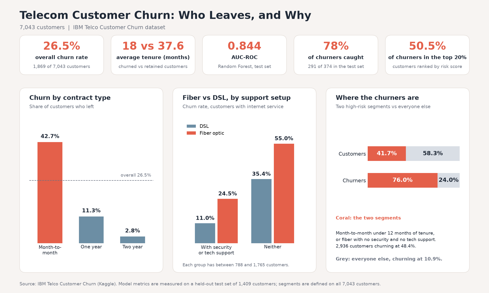

# Telecom Customer Churn: Who Leaves, and Why

About one customer in four left this telecom company (26.5% of 7,043 customers). This project looks at which customers are most at risk, what drives their departure, and what a retention team could realistically do about it.




## The business question

Which customers are likely to churn, and what can the business do to reduce that risk early enough to matter?

## Dataset

[IBM Telco Customer Churn](https://www.kaggle.com/datasets/blastchar/telco-customer-churn): 7,043 customers and 21 columns (customer ID, 19 features on demographics, contract, services and billing, and the churn flag). To run the notebook, download the CSV and save it as `data/raw/telco_churn.csv`.

## Project structure

```
telecom-churn-analysis/
├── data/
│   ├── raw/                      # Original, untouched data
│   └── processed/                # Cleaned data, ready for analysis
├── sql/
│   └── exploration_queries.sql   # Business-facing SQL exploration
├── notebooks/
│   └── 01_churn_pipeline.ipynb   # EDA -> features -> model -> interpretation
├── src/
│   ├── data_loading.py           # Loading and cleaning
│   ├── features.py               # Feature engineering
│   ├── model.py                  # Training and evaluation
│   ├── summary_figure.py         # Builds the summary image above
│   └── visualization.py          # Plotting and testing
├── reports/
│   └── figures/                  # Exported visuals
├── requirements.txt
└── .gitignore
```

## Approach

1. **SQL exploration** of churn by contract type, tenure and payment method, to see whether there's a story worth telling.
2. **EDA in Python**, built around four testable hypotheses (contract, tenure, payment method, add-on services).
3. **Feature engineering:** one-hot encoding plus three features taken from the EDA. The ID and helper columns are dropped so nothing from the target leaks into the model.
4. **Modeling:** a logistic regression baseline, then a Random Forest, compared with cross-validation. Churn is imbalanced, so I focus on recall on the churn class rather than accuracy.
5. **Interpretation with SHAP**, to check what the model relies on against the EDA.

## Key findings

- **Contract and tenure are the clearest patterns.** Month-to-month customers churn at 42.7%, against 11.3% on one-year and 2.8% on two-year contracts. Churned customers had an average tenure of 18 months, against 37.6 for retained ones.
- **Missing support is the strongest signal in the model.** Among customers with internet, those with neither online security nor tech support churn at 55.0% on fiber and 35.4% on DSL, against 24.5% and 11.0% for the others.
- **Fiber optic stands out, and not only because of price.** In the same price band and the same support setup, fiber customers churn more than DSL ones. The data can't say why.
- **Payment method is an indirect signal.** Electronic check payers churn at 45.3%, against 15-19% for automatic payment. Probably a proxy rather than a cause, but cheap to monitor.
- **Two overlapping segments hold three churners out of four.** Month-to-month customers under 12 months of tenure, and fiber customers with no security and no tech support, add up to 2,936 customers (41.7% of the base) churning at 48.4%. Everyone else churns at 10.9%.

## Model performance

Random Forest on a held-out test set: **AUC-ROC 0.844**, about 78% of churners caught (291 of 374), precision of 52%. A logistic regression baseline does almost as well (AUC 0.842, same recall), so the extra complexity buys very little.

About one flagged customer in two is a false alarm, which only makes sense if a retention call costs less than losing a customer. Calling only the top 20% of customers by risk score would reach 50.5% of the churners, about 2.5 times what calling at random would.

## Recommendations

1. Focus the retention budget on the two segments above rather than spreading it across the whole base.
2. Test an incentive to move new month-to-month customers onto a longer contract, and a free trial of security and tech support for fiber customers who don't have them, each with a control group.
3. Look into fiber service quality (outages, speed complaints, competitor offers), since the data doesn't explain the gap.
4. Score the customer base monthly and give the retention team a ranked outreach list. Electronic check payment can serve as an extra, lightweight risk flag.

## Limitations

- Everything here is an association, not proof of cause. Customers on longer contracts or with support services may simply be more engaged to begin with.
- It's a single snapshot of one dataset, with no data on the cost of retention offers.
- The segments were defined on all 7,043 customers, while the model metrics come from a held-out test set, so the two shouldn't be compared directly.

## Stack

Python (pandas, scikit-learn, matplotlib/seaborn, SHAP) · SQL (SQLite) · Git

## Running it

```bash
python -m venv venv
source venv/bin/activate  # venv\Scripts\activate on Windows
pip install -r requirements.txt
jupyter notebook notebooks/01_churn_pipeline.ipynb
```

## Author

Hadidja. MSc in AI & Data Science (in progress), previously IS architecture and applications. Building toward a Data Analyst / Data Scientist role.
[LinkedIn](https://linkedin.com/in/hadidja-adamou) · [Portfolio](https://github.com/hadidja-adamou)
